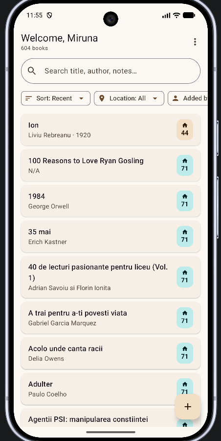
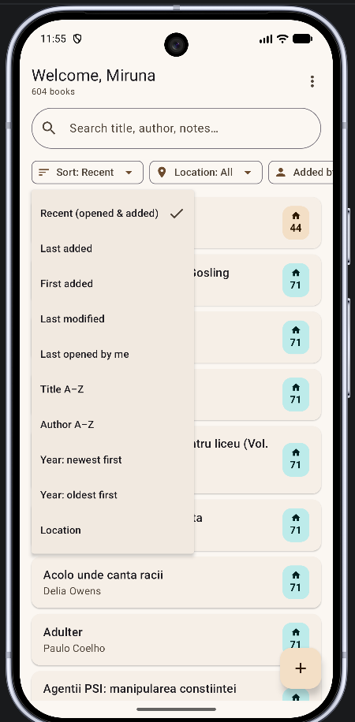
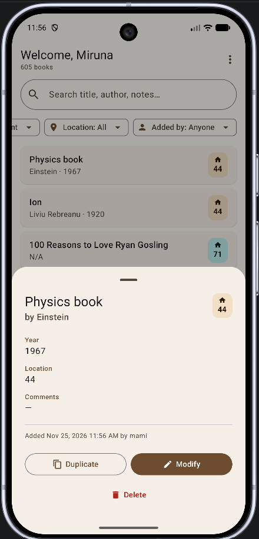
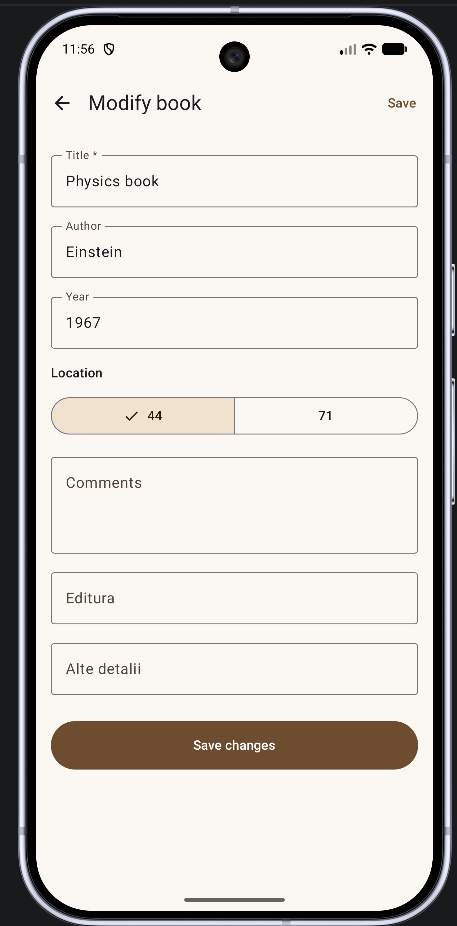
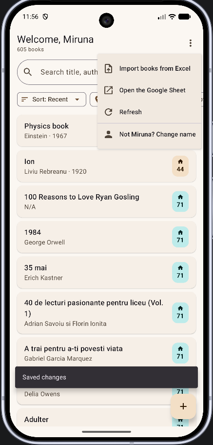
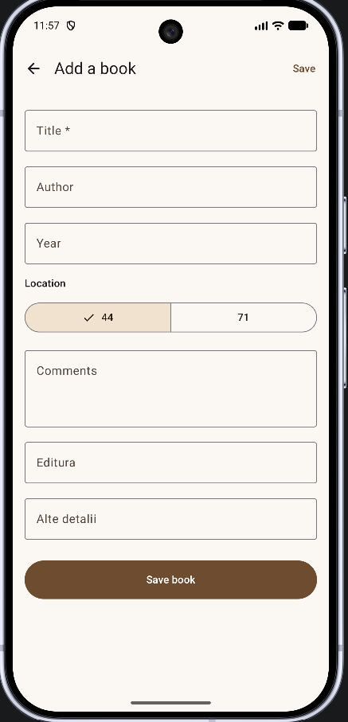

# Family Library

An Android app for my family's book collection. All  of us can browse, search and edit the list from our phones, and every change shows up for everyone.


<p float="left">
  
  
  
  
  
  
</p>


## Why I built it
 
Over the years my family collected so many books that we had to keep them in different places. We realised we needed some kind of organisation when we kept buying books we already owned. Having the books spread across different places made it hard to know what we had, but the main problem was just how many there were. So we started keeping a list in a spreadsheet.
 
That helped, but only partly. The spreadsheet was awkward to open on a phone, and adding or editing a book there was annoying. So I turned the list into an app that everyone in the family can use easily and that stays in sync.
 
## Features
 
- **Main view:** a scrollable list of all the books, with author, year and where the book is kept
- **Search:** searches titles, authors and notes (and ignores diacritics)
- **Sort:** recently opened and added (default), last added, first added, last modified, last opened, title, author, year or location
- **Filter:** by location, or by who added the book
- **Add, edit, duplicate and delete books**
- **Sign in with just your name:** no password
- **Sync:** changes from any phone, or from the spreadsheet itself, show up on the others within about 15 seconds
- **Pull down to refresh**
- **Open the Google Sheet** straight from the app
- **Import books from other Excel or CSV files:** duplicates are skipped!!!
## Design choices
 
**Google Sheet as the "database".** My family already had the list in a spreadsheet and were used to it. Keeping the data in a Google Sheet means they can still edit it there or download it as Excel, while the app reads and writes the same sheet. A small Google Apps Script on the sheet acts as the app's backend.
 
**Name-only sign-in.** It's a family app and the data isn't private, so I wanted it to be as easy as possible to start using. You type your name once and the app remembers it. The name is saved with each change, so we can see who added or edited a book.
 
**Checking for changes every 15 seconds.** Google Sheets can't push updates to the phones, so while the app is open it asks the sheet whether anything changed. It only downloads the full list when something did, which keeps it quick and light on data.
 
**Instant updates.** When you add, edit or delete a book, the change shows straight away and is sent to the sheet in the background. If saving fails, the app undoes it and tells you.
 
**My own Excel reader.** An `.xlsx` file is a zip of XML files, so I wrote a small reader instead of adding a big library like Apache POI, which would have made the app a lot bigger.
 
**Kotlin + Jetpack Compose.** Compose is what Google now recommends for new Android apps, and I'd already used it for my Habit Tracker, so I kept going with it.
 
**MVVM with one UI state object.** All the app's state lives in `LibraryViewModel`, in a single `UiState`. The screens only display it and report what the user tapped, so there's one source of truth and the screens stay simple.
 
## Testing
 
**Manual testing.** I installed it on our phones and went through the main flows:
- signing in with different names
- adding, editing, duplicating and deleting books, and checking they show up on the other phones and in the sheet
- editing the sheet directly and checking the app picks it up
- search, filters and every sort option
- importing Excel and CSV files
**Real data.** The app runs on our actual collection of 600+ books, imported from the spreadsheet we already had.
 
## Built with
 
- Kotlin
- Jetpack Compose + Material 3
- Android ViewModel (MVVM) + Kotlin coroutines
- Google Sheets + Google Apps Script
## Project structure
 
```
app/src/main/java/com/example/library/
├── MainActivity.kt   # app entry point
├── Config.kt         # link to the Google Sheet
├── data/             # Book model, talking to the sheet, Excel reader, search and sort
└── ui/               # screens, ViewModel, theme
google-sheet/
└── Code.gs           # the script that runs on the Google Sheet
```
 
## Running it
 
1. Clone the repo
```
git clone https://github.com/mirunadobrescu06/Family-Library.git
```
2. Put your books in a Google Sheet, add `google-sheet/Code.gs` under **Extensions > Apps Script**, and deploy it as a Web app (Execute as: Me, Who has access: Anyone)
3. Paste the Web app link into `Config.kt`
4. Open the project in Android Studio and run it on an emulator or an Android phone
   
## What I learned
 
- Connecting an app to an online backend and keeping several phones in sync
- Writing a small API with Google Apps Script
- Handling things going wrong, like no internet or two people editing at once
- Reading Excel files without a library
- Building screens in Jetpack Compose and managing state
  
## What I'd add next
 
- Scanning a book's barcode to fill in the details automatically
- Book covers
- A "borrowed by" field, to keep track of books lent to friends
- Working fully offline, with changes sent once the phone is back online
